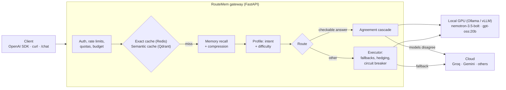
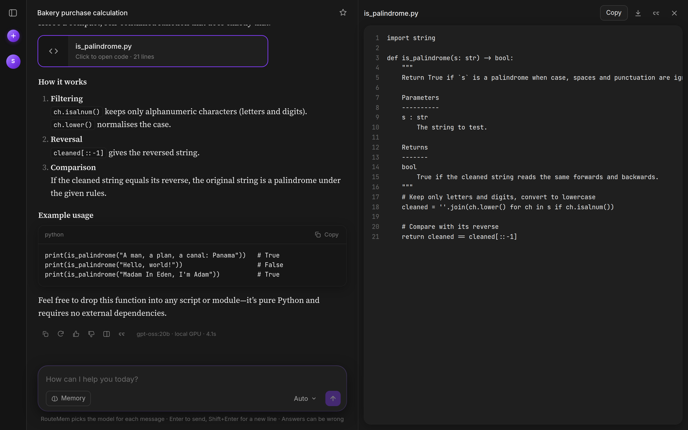
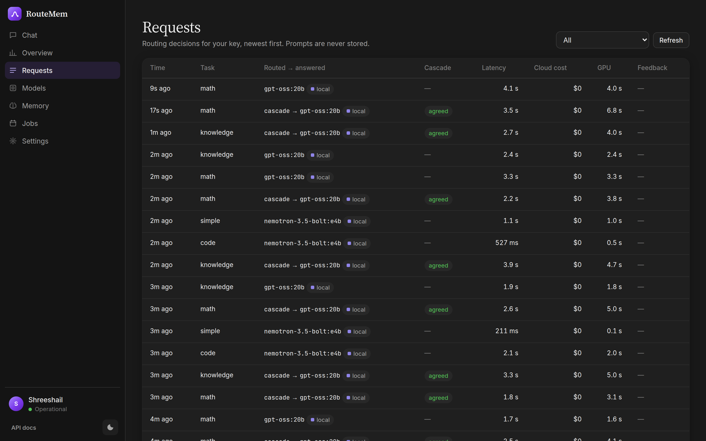
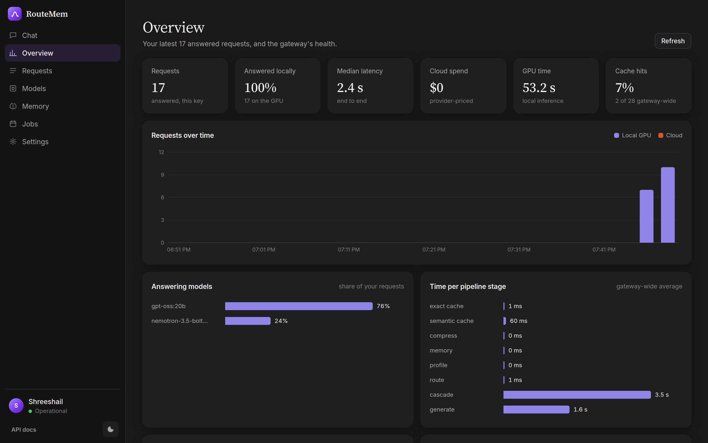
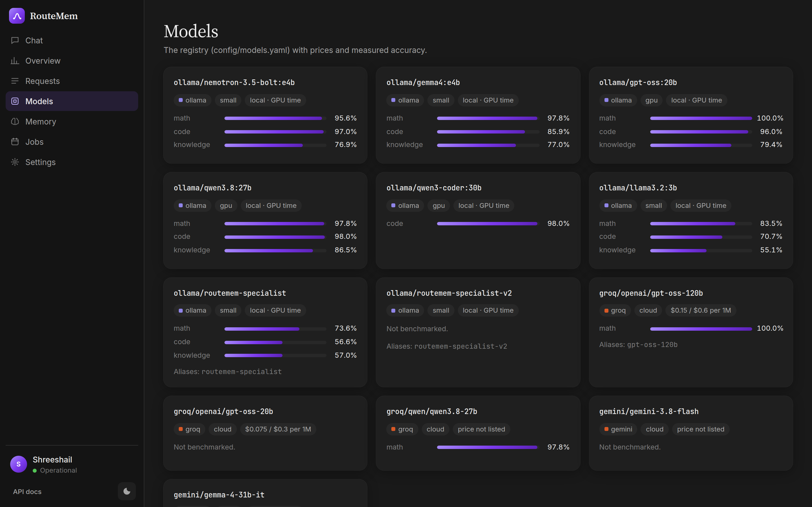
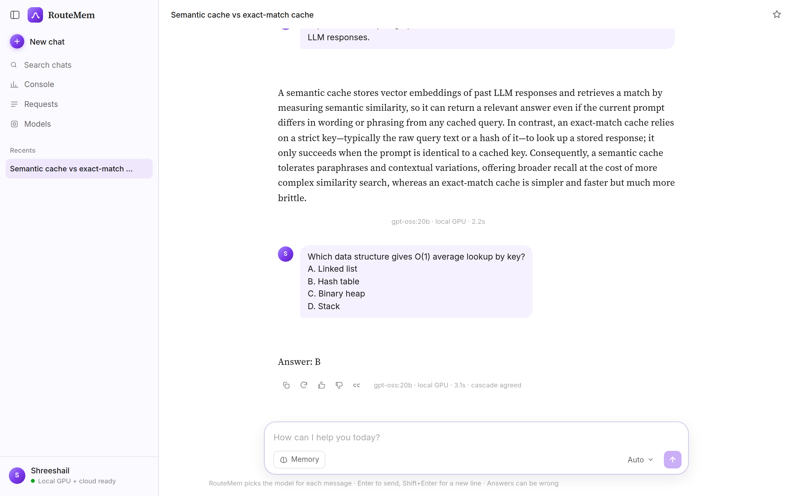
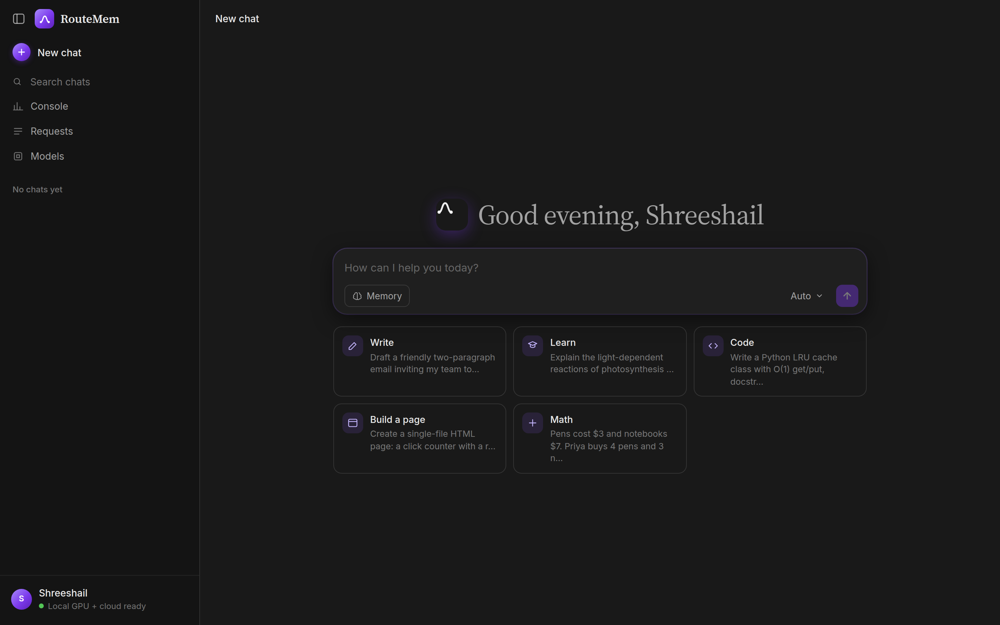

# RouteMem

**An OpenAI-compatible LLM gateway that decides which model answers each request, checks answers where they can
be checked, and reports the cost of every decision.**

Point any OpenAI SDK at RouteMem and send `model: "routemem-auto"`. The gateway routes the request to a local GPU
model or a cloud model, falls back when a backend fails, caches and remembers, and returns a `routemem_metadata`
block with the model that answered, why, how long each stage took and what it cost.

The research question behind it: **can small local models answer most questions as well as a larger cloud model,
if the gateway verifies them first?** On the measured setup, the agreement cascade answers 84% of checkable
questions locally and stays within 0.5 points of its cloud escalation model.

> This repository is the public showcase: design, measured results, screenshots and a demo. The source code is
> in a private repository.


<sub>Recorded on the AWS deployment (A10G GPU worker). Full-quality video: [docs/media/demo.mp4](docs/media/demo.mp4).</sub>

---

## Measured results

Every number below comes from real model calls scored against gold answers. Method, confidence intervals and
charts: **[docs/EVALUATION.md](docs/EVALUATION.md)**.

| What | Result |
|---|---|
| Agreement cascade vs its own cloud escalation model (565 non-code questions) | **89.6% vs 90.1%**, with **84%** answered by the local GPU |
| Agreement cascade on 240 held-out questions (live) | **89.6%** vs 87.5% for the best single fast model (+2.1, not significant at n = 240) |
| Cascade replay on 710 benchmark answers | **91.0%** vs 87.3% for task routing (+3.7, significant), 13% escalated |
| Learned intent classifier (routing input) | **94.0%** on held-out prompts vs 61.4% for keyword rules |
| Serving on one A10G, gpt-oss-20b, 16 concurrent requests | **vLLM 456.6 tok/s vs Ollama 173.5 tok/s** (2.6×); TTFT p50 0.14 s vs 9.6 s ([details](reports/serving/summary.md)) |
| Latency while the GPU worker is stopped | **~135 s → ~1.5–2 s** per request (3 s connect timeout + circuit breaker) |
| LLMLingua-2 compression at rate 0.5 (HotpotQA, 150 questions) | 46% fewer context tokens, −3.0 F1 (not significant) |
| Live accuracy gate (100 fixed questions, run before a deploy is trusted) | 85–87% (baseline 85.0%) |

What did **not** work, also measured: fine-tuning a 3B base model lowered its accuracy (−4.3 and −3.1 points), and
per-task learned escalation did not beat random routing. Choosing better base models helped more.

---

## How it works



1. **Caches.** An exact cache (Redis) and a semantic cache (Qdrant, bge-small). A semantic hit also needs the same
   numbers, negations and key terms, so "2 + 3" never returns the answer to "2 + 4".
2. **Memory.** With a `session_id`, the most relevant earlier turns are recalled (local SQLite, optional Zep) and
   passed to the model as data. Slow memory backends are timed out and paused, never waited on.
3. **Routing.** A learned classifier picks the task (simple, code, math, knowledge); a declarative routing policy
   maps each task to the model that measured best on it.
4. **Agreement cascade.** For questions with a checkable final answer (multiple choice, numeric), two local models
   answer in parallel. If they agree, the local answer is returned; if not, the question goes to the cloud. 5% of
   agreements are re-checked in the background to label the router's training data.
5. **Executor.** Each model has an ordered fallback chain. An answer never mixes two models: a failure after the
   first token is an error, not a silent switch. If the GPU is unreachable, a circuit breaker skips it for 60 s.
6. **GPU on demand.** The GPU worker stops when idle. The first local request starts it again (trying `g5`, then
   `g6`, then another availability zone); traffic uses the cloud until it is warm.

Full design (deployment topology, request pipeline, cascade, executor, memory, jobs, learning loop, data stores,
API, observability, operations): **[docs/ARCHITECTURE.md](docs/ARCHITECTURE.md)**.

---

## Screenshots

| Chat: cascade-verified answer and code artifact | Console: routing decisions per request |
|---|---|
|  |  |
| **Console: overview** | **Console: model registry with measured accuracy** |
|  |  |
| **Chat: light theme** | **Chat: start page** |
|  |  |

---

## Using it

RouteMem speaks the OpenAI API, so existing clients work unchanged:

```python
from openai import OpenAI

client = OpenAI(base_url="https://<gateway>/v1", api_key="<your key>")
r = client.chat.completions.create(
    model="routemem-auto",
    messages=[{"role": "user", "content": "A train travels 120 km in 1.5 h. Average speed?"}],
)
print(r.choices[0].message.content)
print(r.model_extra["routemem_metadata"])   # model chosen, cascade result, cost, stage timings
```

---

## Features

| Area | What exists |
|---|---|
| API | `POST /v1/chat/completions` (streaming), `/v1/models`, async jobs (`/v1/jobs`), feedback, memory view/forget, chat titles |
| Routing | task routing, agreement cascade, learned escalation (promoted only if it beats the shipped router), budget fallback |
| Reliability | per-model fallback chains, hedged requests, fast-failing GPU connects, circuit breaker, durable job queue with retries |
| Cost control | per-key rate limits and daily token quotas, monthly cloud budget cap, cost and GPU-seconds on every response |
| Observability | `routemem_metadata` per response, Prometheus metrics, OpenTelemetry spans per stage, JSON logs, decision log |
| UI | chat (threads, auto-titles, markdown, code artifacts, profiles, light/dark) and a console (usage, routing, models, memory, jobs) |
| Evaluation | benchmark runner, policy replay with bootstrap CIs, held-out set, offline gate in CI, live gate, serving benchmark |
| Ops | Terraform for AWS, HTTPS via Caddy, S3 backups every 6 h, idle auto-stop alarms, one-command dev mode |

**Stack:** Python, FastAPI, vLLM, Ollama, Redis (Streams), Qdrant, SQLite, LLMLingua-2, Prometheus, OpenTelemetry,
Docker, Terraform, AWS (EC2 g5/t4g, IAM, CloudWatch, S3), GitHub Actions.

## Deployment

A `t4g.xlarge` control plane (gateway, Redis, Qdrant, SQLite behind Caddy HTTPS) and a `g5.xlarge` GPU worker
(A10G 24 GB) running Ollama with both cascade models resident. The GPU stops itself when idle and is woken on
demand, so the whole system runs for a few dollars a day of active use.

## Known limits

- The cascade runs both local models on every checkable question, costing about 40% of GPU throughput; a
  confidence-gated variant is written but not yet measured.
- Stateful services share one control-plane host: backed up to S3, but with no failover.
- Memory stores conversation snippets, not extracted facts.
- No self-serve accounts or billing yet.

## Documents

| Document | What it covers |
|---|---|
| [docs/ARCHITECTURE.md](docs/ARCHITECTURE.md) | design: topology, pipeline, cascade, executor, GPU on demand, data stores, API |
| [docs/EVALUATION.md](docs/EVALUATION.md) | all measured results with method and confidence intervals |
| [reports/serving/summary.md](reports/serving/summary.md) | Ollama vs vLLM serving benchmark |
| `reports/` | per-experiment summaries and charts referenced by the evaluation report |

## Source code

The implementation is private. If you are evaluating this work (hiring, research collaboration), message me on
GitHub or LinkedIn and I can walk you through the code.

---

Built by [Shreeshail Chavan](https://github.com/shreeshailchavan). © 2026, all rights reserved.
