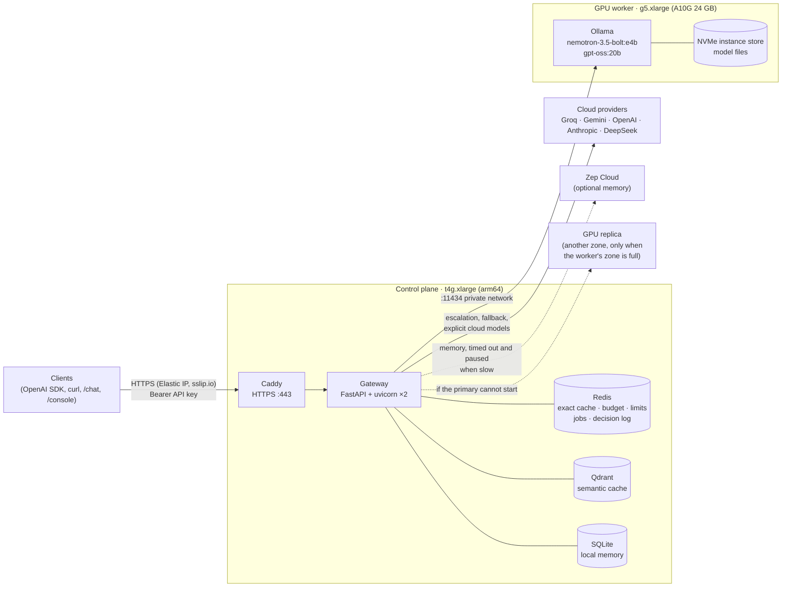
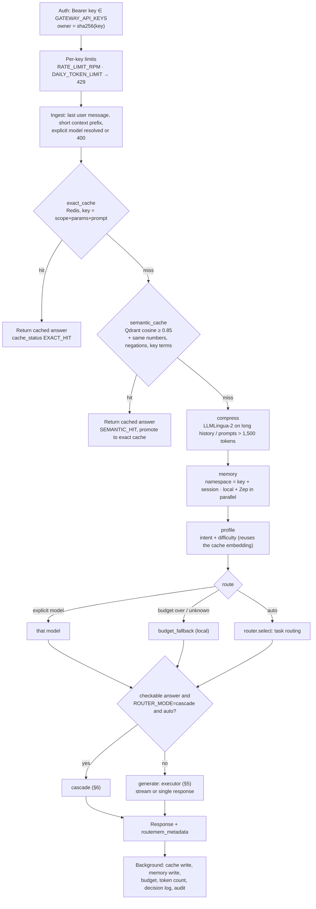
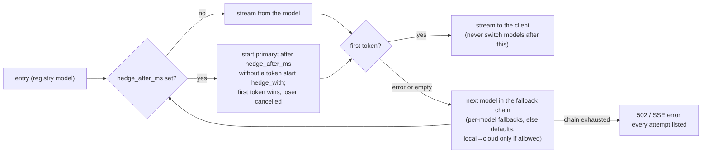
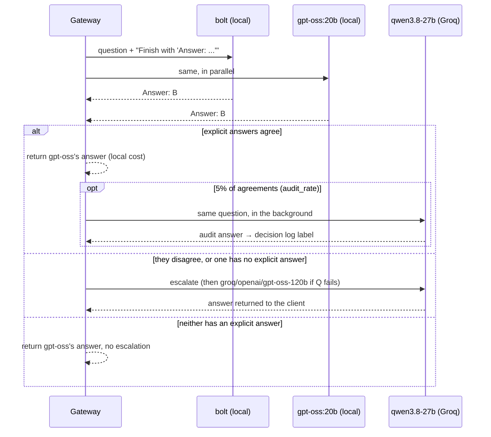
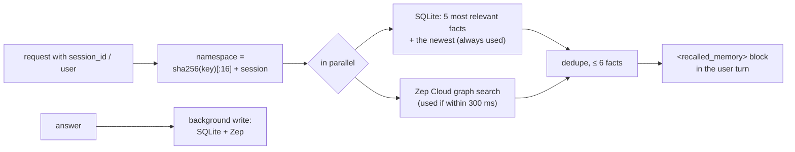
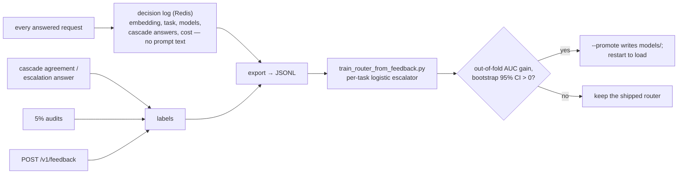
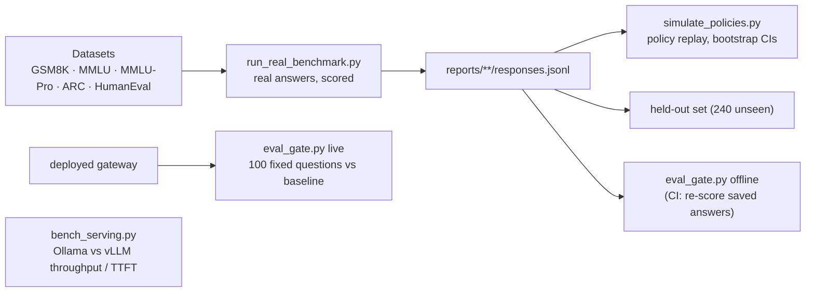

# RouteMem architecture

Current as of 2026-11-08 (`feat/saas-guards`). This is the reference for how the system is built and how
a request flows through it; where it and the code disagree, the code wins. Measured results are in [EVALUATION.md](EVALUATION.md), open problems in
the system review (in the private code repository).

## 1. What RouteMem is

An OpenAI-compatible LLM gateway. Clients call `POST /v1/chat/completions` as they would call OpenAI; RouteMem
decides which model answers, checks answers where they can be checked, caches and remembers, and reports every
decision in `routemem_metadata` on the response.

The goal is frontier-adjacent answers at local-GPU cost: on the deployed setup the agreement cascade answers
84% of checkable questions on the local GPU and reaches about the accuracy of its cloud escalation model
(89.6% vs 90.1% for qwen3.8-27b alone on 565 replayed questions; live gate 85–87% on 100 fixed questions).

## 2. Deployment topology



| Piece | Where | Notes |
|---|---|---|
| Gateway | control plane, `routemem-gateway.service` | 2 uvicorn workers; each also runs a job worker |
| Redis, Qdrant | control plane, Docker, localhost only | not reachable from the network |
| Local models | GPU worker, Ollama | both cascade models stay resident (~21 GB); `OLLAMA_NUM_PARALLEL=4`; models on NVMe, warmed at boot |
| Cost guard | CloudWatch alarms | stop the GPU worker after 20 min and the control plane after 2 h below 2% CPU (`devctl.sh alarms`; the GPU alarm was 60 min before) |
| Network | security groups, Caddy | HTTPS on 443 via Caddy (API key required), 22 from the admin IP (`devctl.sh ssh-ip`), 11434 from the gateway only |
| GPU replica | launch template `routemem-gpu-replica` | started in another zone only when the worker's zone has no capacity; terminated when the primary is back or after 1 h unused (§15) |
| Infrastructure as code | `infra/terraform` | state in S3; adoption plan 4 add / 4 change / 0 destroy (not yet applied) |

When the GPU worker is stopped or unreachable, local-routed requests fall back to Groq within ~3 s (see §5);
`/ready` reports `cloud_fallback` and, in `gpu_worker`, which worker (primary or replica) is serving.

## 3. Code map

```
app/
  main.py            HTTP endpoints and the request pipeline (handle_chat)
  config.py          all settings (env vars / .env) and config/models.yaml loading
  schemas.py         request/response models, RouteMemMetadata
  jobs.py            durable job queue (Redis Streams) and its worker
  router/
    registry.py      model registry: names, providers, prices, fallbacks, hedging
    profiler.py      intent + difficulty from the prompt and its embedding
    router.py        task routing (and learned / per-task escalation modes)
    cascade.py       agreement cascade, answer-kind detection, audit sampling
    executor.py      runs one request on a model: fallback chains, hedged requests, GPU seconds
    feedback.py      decision log, labels from cascade / audits / client feedback
    learning.py      escalator training and promotion gate (offline)
  backends/          one client per provider; each makes exactly one attempt
  cache/             exact (Redis) and semantic (Qdrant, bge-small) caches
  memory/            memory service (namespaces, budget), Zep + SQLite stores, LLMLingua-2 compressor
  utils/             answer extraction, cost, quotas, metrics, tracing, logging, GPU waker
  static/console/    chat UI (chat.html, chatapp.js, chat.css) at /chat, console (index.html, app.js,
                     styles.css) at /console; shared theme.css and profile.js
config/models.yaml   registry, task routing, cascade (the routing policy lives here, not in code)
scripts/             benchmarks, policy replay, training, eval gate, GPU jobs
infra/terraform/     gateway + GPU worker, security groups, IAM, alarm
infra/iam/           hand-applied IAM policies (GPU replicas in other zones)
scripts/ops/         devctl.sh (dev-mode up/down/status/cost), backups, TLS
```

## 4. Request pipeline

Every `POST /v1/chat/completions` goes through `chat_completions` → `handle_chat` in `app/main.py`. Each named
stage is timed into `routemem_metadata.stage_ms`, the `routemem_stage_seconds` histogram and an OpenTelemetry
span.



Stage notes:

| Stage | What it does | Key settings |
|---|---|---|
| Auth and limits | Bearer key checked in constant time; `owner` (hash of the key) scopes jobs, memory, caches, decisions and limits. Open when `GATEWAY_API_KEYS` is empty (local dev only). | `GATEWAY_API_KEYS`, `RATE_LIMIT_RPM` (120), `DAILY_TOKEN_LIMIT` (0 = off) |
| Exact cache | SHA-256 of scope, generation params, system prompt, context and prompt. `cache_mode=bypass` skips it. | `EXACT_CACHE_TTL_SECONDS` (24 h), `CACHE_SCOPE=user` |
| Semantic cache | bge-small-en-v1.5 embedding, Qdrant search filtered by scope, params and age; a hit also needs identical numbers, negation words and ordered key terms (entities, languages, units, contrasts). | `SEMANTIC_CACHE_THRESHOLD` (0.85), `SEMANTIC_CACHE_TTL_SECONDS` (24 h) |
| Compress | LLMLingua-2 (xlm-roberta) in a worker thread; short prompts pass through. Measured: −46% tokens, −3.0 F1 (not significant). | `COMPRESSION_RATE` (0.5), `COMPRESS_PROMPT_OVER_TOKENS` (1,500) |
| Memory | Only with `session_id` or `user`. Local SQLite facts always; Zep Cloud facts if they arrive within the budget, and Zep is skipped for 5 minutes after 2 misses in a row. Sent to the model as an escaped `<recalled_memory>` block in the user turn; the system prompt says it is data. | `MEMORY_TIMEOUT_MS` (300; 120 on the deployment), `MEMORY_ENABLED` |
| Profile | Intent (`simple_qa`, `code_generation`, `complex_reasoning`, `domain_expert`) from a learned classifier on the query embedding (`models/intent_classifier.json`: 94.0% on held-out prompts vs 61.4% for the old keyword rules); difficulty 0–1 from the rules. Picks the default system prompt and output cap. | — |
| Route | Explicit model, else budget fallback, else task routing (`config/models.yaml: task_routing`). | `ROUTER_MODE` (`task` / `cascade` / `learned`), `MONTHLY_BUDGET_LIMIT_USD`, `BUDGET_FAIL_OPEN` |
| Generate | Executor runs the model with its fallback chain (§5). Output cap: client `max_tokens`, else the intent cap raised to the model's `min_output_tokens` (reasoning models need ≥ 1,024). | `LOCAL_TIMEOUT_S` (180), `LOCAL_CONNECT_TIMEOUT_S` (3), `LOCAL_FALLBACK_TO_CLOUD` |
| Background | Cache and memory writes, spend, token usage, decision log, cascade audit; held in a task set so none is dropped mid-flight. | — |

Current task routing (`config/models.yaml`):

| Task (from intent) | Model | Why (measured) |
|---|---|---|
| simple | `ollama/nemotron-3.5-bolt:e4b` | fast, adequate |
| code | `ollama/nemotron-3.5-bolt:e4b` | HumanEval 95.1%, best small model |
| math | `ollama/gpt-oss:20b` | GSM8K 97–100% |
| knowledge | `ollama/gpt-oss:20b` | beats bolt on ARC/MMLU/MMLU-Pro on the same questions |

## 5. Executor: fallbacks and hedging

Backends make one attempt and raise `BackendError`; `app/router/executor.py` decides what happens next from the
registry.



- Invariant: an answer never mixes two models. A failure after the first token is an error, not a fallback.
- An empty answer counts as a failure.
- `routemem_metadata.fallback_reason` lists each failed attempt; `hedge` shows primary, hedge and winner.
- Local attempts add their wall time to `gpu_seconds` (failed ones too), priced at `GPU_HOURLY_USD` into
  `gpu_cost_usd`. That is separate from `cost_usd` (cloud spend, which the budget caps).
- Defaults: local models fall back to `groq/openai/gpt-oss-20b`, then `groq/openai/gpt-oss-120b`.
- Fast failure when the GPU is down: a local connect gives up after `LOCAL_CONNECT_TIMEOUT_S` (3 s) and raises
  `BackendError(unreachable=True)`. That opens a circuit breaker: for `LOCAL_DOWN_COOLDOWN_S` (60 s) local
  candidates are skipped when a cloud model follows in the chain (`fallback_reason`: "skipped (GPU worker
  unreachable, retrying in Ns)"). The breaker resets as soon as the GPU watcher sees a worker come up. Before
  this, every request waited on the 180 s timeout (~135 s measured); now ~1.5–2 s.

## 6. Agreement cascade

Used when `ROUTER_MODE=cascade` (deployed), the request is automatic (`routemem-auto`), the budget is not capped,
and the question has a checkable final answer: multiple choice (options `A.`–`J.` on their own lines) or a
reasoning prompt that contains numbers.



- Answers are compared only as explicit finals (`Answer: x`, `\boxed{x}`); a number found in prose is never an
  answer. The gateway adds the format instruction itself, because user prompts do not ask for it.
- `stream: true` works: the gateway sends SSE `: keepalive` comments while the models run, then the verified
  answer as one chunk, then metadata.
- Usage and cost in the response cover every call the cascade made.
- Measured on 565 replayed questions: 84% agreement, agreed answers right 92.6% of the time, 16% escalated.

## 7. Memory layer



- Requests without a session or user are stateless.
- A fact is `User said: … | Assistant replied: …`, stored with the embedding of what the user said; recall ranks
  the session's latest 500 facts by similarity to the question and always keeps the newest turn.
- `GET /v1/memory/{session}` lists facts; `DELETE` forgets them and deletes that session's cached answers.

## 8. Durable jobs

`POST /v1/jobs` stores a chat request in Redis and returns `202 {id}`; workers in each gateway process run it
through the same pipeline. Poll `GET /v1/jobs/{id}`.

| Redis key | Content |
|---|---|
| `routemem:job:<id>` | status, request, owner, attempts, error, result (TTL 7 days) |
| `routemem:jobs` | stream of job ids, consumer group `workers` |
| `routemem:jobs:delayed` | retries due later (sorted by time) |

Lifecycle `queued → running → succeeded | failed`. 5xx/429 retry with exponential backoff (`JOB_BACKOFF_S`,
`JOB_MAX_ATTEMPTS`); 4xx fail at once; a crashed worker's job is reclaimed (`XAUTOCLAIM`). Jobs are visible only
to the key that created them.

## 9. Router learning loop



Seeded with 565 replayed decisions (`data/router_seed/`). Raw agreement labels miss about half of real errors,
so audits and feedback are the labels to trust; a trained escalator is promoted only when it beats the shipped
one.

## 10. Data stores

| Store | Keys / collection | Retention |
|---|---|---|
| Redis | `exact_cache:<hash>`, `exact_cache_scope:<scope>` | 24 h |
| Redis | `routemem:spend:<YYYY-MM>` | 40 days |
| Redis | `routemem:rl:req:<owner>:<minute>`, `routemem:rl:tok:<owner>:<day>` | 2 min / 2 days |
| Redis | `routemem:job:*`, `routemem:jobs`, `routemem:jobs:delayed` | 7 days |
| Redis | `routemem:decisions` (stream), `routemem:decision:<response_id>` | 200k entries / 30 days |
| Qdrant | `routemem_semantic_cache` (prompt, response, scope, params, created_at) | 24 h (filtered at lookup) |
| SQLite | `data/graphiti_memory.db`, table `session_facts` | until deleted |
| Zep Cloud | user graph per namespace | Zep's retention |

## 11. HTTP API

| Endpoint | Auth | Purpose |
|---|---|---|
| `POST /v1/chat/completions` | key | OpenAI-compatible chat; `stream`, `session_id`, `cache_mode` (`default`/`bypass`) |
| `GET /v1/models` | key | registry with prices, tiers and measured per-task metrics, plus `routemem-auto` |
| `POST /v1/jobs`, `GET /v1/jobs/{id}` | key | asynchronous, retried completions |
| `POST /v1/feedback` | key | `{response_id, correct}` labels a routing decision |
| `GET`/`DELETE /v1/memory/{session_id}` | key | view / forget a session's memory (and its cached answers) |
| `POST /v1/admin/cache/clear` | `X-Admin-Token` | flush caches and memory; disabled without `ADMIN_TOKEN` |
| `GET /health` | none | liveness |
| `GET /ready` | none | Redis, Qdrant, routed local models, cloud keys → `local+cloud` / `cloud_fallback` / `local_only` / `unavailable` (503) |
| `GET /metrics` | none | Prometheus |
| `GET /chat` | page none, calls use the key in the profile | chat UI: threads, streaming, markdown, auto-titles, profile and theme |
| `GET /console` | page none, calls use the key in the profile | RouteMem Console: overview charts, requests, models, memory, jobs, settings |
| `POST /v1/chat/title` | key | 2–5 word title for a conversation from its first exchange (`TITLE_MODEL`, fallback from the text) |
| `GET /v1/requests` | key | the caller's latest routing decisions, newest first (no prompt text) |
| `GET /playground` | none | 307 redirect to `/chat` |
| `GET /docs` | none | Swagger UI |

`routemem_metadata` on every response: `cache_status`, `target_routed_model`, `actual_answering_model`,
`answering_provider`, `is_fallback`/`fallback_reason`, `hedge`, `cascade`, `intent`, `difficulty`,
`budget_capped`, `kg_memory_used`, `cost_usd`, `gpu_seconds`, `gpu_cost_usd`, `usage_source`, `ttft_ms`,
`latency_ms`, `stage_ms`, `token_reduction_ratio`.

## 12. Configuration

Routing policy lives in `config/models.yaml`:

- `registry`: every model by exact name (`ollama/<tag>`, `groq/<id>`, `gemini/<id>`, …), with tier, prices,
  `min_output_tokens`, `fallbacks`, `hedge_after_ms`/`hedge_with`, aliases. Unknown names are rejected (400),
  never guessed.
- `defaults`: `budget_fallback`, `fallbacks_local`, `fallbacks_cloud`.
- `task_routing`: intent → task → local model (+ optional cloud escalation and `escalation_router`).
- `cascade`: `first_stage` (two models), `prefer`, `escalate` (ordered), `audit_rate`.

Everything else is an environment variable (`app/config.py`); secrets come only from the environment
(`.env` locally, SSM Parameter Store in the Terraform deployment).

## 13. Observability

- Response: `routemem_metadata` (above) on every answer, including stream metadata as the last SSE event.
- Prometheus (`/metrics`): requests, cache hits by type, TTFT, stage latency by stage, GPU seconds by model,
  token reduction.
- OpenTelemetry: a span per stage (`routemem.<stage>`), exported when the service runs under an OTel SDK
  (e.g. `opentelemetry-instrument` with `OTEL_EXPORTER_OTLP_ENDPOINT`).
- Logs: JSON lines per module.

## 14. Evaluation pipeline



- CI (GitHub Actions): unit and integration tests (Redis service for queue, limits and cache tests) and the
  offline gate.
- Before a deploy is trusted: smoke test (`scripts/smoke_test_gateway.py`) and live gate (baseline 85.0%).

## 15. Operations

| Concern | Mechanism | Where |
|---|---|---|
| GPU stopped by the idle alarm | gateway starts it on the first failed local attempt (one attempt per cooldown); requests use the cloud meanwhile | `app/utils/gpu_waker.py`, `GPU_INSTANCE_ID` |
| No GPU capacity in the worker's zone | instance types tried in preference order (`GPU_FALLBACK_INSTANCE_TYPES=g5.xlarge,g6.xlarge`); if none fits, a replica is launched from the worker's image in the first other zone with capacity (`GPU_REPLICA_SUBNETS`) | `GPU_LAUNCH_TEMPLATE`, `infra/iam/gpu-replica-policy.json` |
| Which GPU serves | every 30 s the gateway checks the primary and replicas and points local traffic at the running one (primary first); a replica is terminated when the primary is back or after `GPU_REPLICA_IDLE_S` (1 h) unused; a Redis lock stops two processes launching two replicas | `gpu_watch` in `app/main.py`, `active_ollama_url` |
| Dev mode | everything off by default; `devctl.sh up [--gpu]` / `down` / `status` / `cost` / `ssh-ip` / `alarms` | `scripts/ops/devctl.sh` |
| State durability | Redis, Qdrant and SQLite archived to S3 every 6 h (30-day expiry); tested restore | `scripts/ops/backup_state.sh`, `restore_state.sh`, `routemem-backup.timer` |
| Transport security | Caddy terminates HTTPS on a fixed Elastic IP (`<ip>.sslip.io` without a domain) | `scripts/ops/install_tls.sh`, Terraform `aws_eip` |

The Terraform module provisions all three; on the hand-built deployment they take effect when the adoption plan
is applied.

## 16. Known limits

Tracked with evidence and proposals in the system review (in the private code repository). Open:

- The cascade runs both local models on every checkable question, costing ~40% of gpt-oss throughput on one A10G
  (R2). `scripts/eval_confidence_gate.py` measures the confidence-gated alternative; it needs the GPU.
- Memory facts are snippets of the conversation, not extracted facts; there is no conflict resolution between them.
- Gateway, Redis, Qdrant and SQLite share one host: backed up every 6 h, no failover.
- GPU replicas need the IAM policy in `infra/iam/gpu-replica-policy.json` applied to the gateway role; without
  it, a full zone means cloud-only answers until capacity returns.
- No self-serve accounts or billing: API keys are set in `GATEWAY_API_KEYS`.
