# RouteMem: Architecture and Measured Evaluation

This report replaces the earlier simulated results. Every number below was produced by calling real
models and scoring their answers against gold labels; the scripts and raw responses are in the repo.

## Headline results

| Question | Result | Evidence |
|---|---|---|
| How good was RouteMem as deployed? | **28.0%** on 200 questions, 28.5 points **below** random routing (95% CI −36.9 to −20.1) | `reports/real_benchmark/` |
| After fixing the gateway? | **65.5%** on the same questions, **+9.0 points above** random routing (CI +2.0 to +15.4) | `reports/real_benchmark_after_fix/` |
| Best available models per task? | Small: `nemotron-3.5-bolt:e4b` / `gemma4:e4b` (~80% overall vs 55.6% for the v1 specialist). GPU worker: `qwen3.8:27b` (91.7%), `gpt-oss:20b` (84.2%) | `reports/large_eval/summary.md` |
| Best routing policy (replay of 710 real answers)? | **Agreement cascade 91.0%** vs 87.3% for task routing (+3.7, CI +1.8 to +5.4), 13% escalated | `reports/policies/summary.md` |
| Does it hold on unseen questions (240, live)? | **Cascade 89.6%** vs 87.5% for the best single fast model (+2.1, CI −0.8 to +5.4: same direction, not significant at n = 240); heuristic routing 64.2% | `reports/holdout_eval/cascade.md` |
| Does LLMLingua-2 compression hurt? | At rate 0.5: **46% fewer context tokens, −3.0 F1 (not significant)**; at rate 0.33: −15.8 F1 (significant) | `reports/compression/summary.md` |
| Did the fine-tuned specialists help? | No. v1 is **4.3 points worse** than its base (CI −6.7 to −1.8); v2 is **3.1 points worse** than its base at the same quantization (CI −5.4 to −0.8) | `reports/finetune/comparison.md` |

## 1. The system as deployed

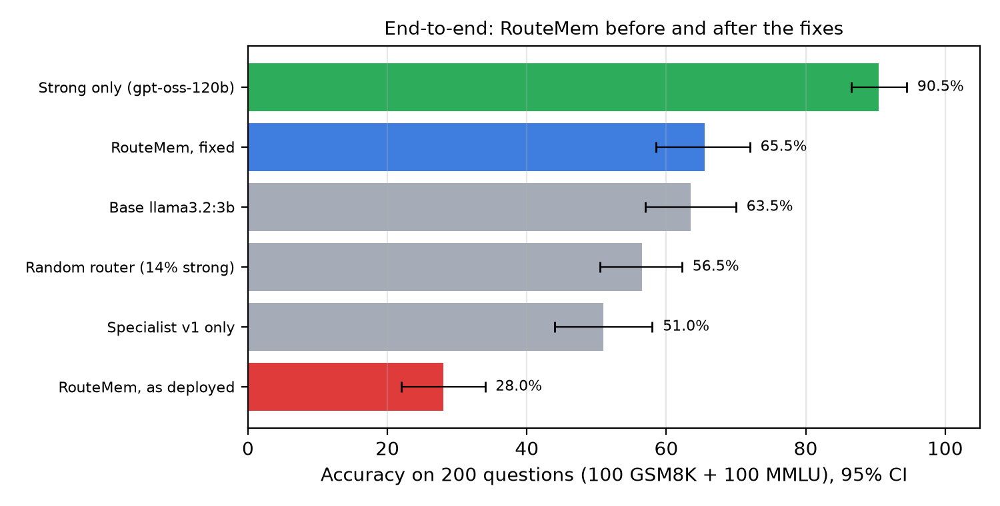

Measured on 100 GSM8K + 100 MMLU test questions through the gateway (`cache_mode: bypass`), RouteMem scored 28.0%
against 90.5% for the strong model alone. Causes, each confirmed in the code and the logs:

- **The "compressor" altered 183 of 200 prompts**: it deleted multiple-choice options and words such as "not".
  Prompts it left alone scored 82%, altered ones 23%.
- **Routing sent 47% of questions to `deepseek-r1:1.5b`**, which scores 16% on MMLU-Pro and returned empty answers 20 times.
- **Backends fabricated success**: missing keys or errors produced text like "Response generated successfully", and a
  failed local model silently fell back to Groq while reporting itself as local.

The fixed gateway (honest backends, LLMLingua-2 only on long context, scoped caches, real costs) reached 65.5% on the
same questions.

## 2. Model selection

Seventeen models (local small, GPU-worker, cloud) answered up to 1,364 test questions: GSM8K, MMLU, MMLU-Pro,
ARC-Challenge (300 each) and all 164 HumanEval problems, the code run against its unit tests in a no-network sandbox.
Within each tier, models are ranked on the questions all of them answered.

| Task | Best small model | Best GPU-worker model | Current RouteMem routing (replayed) |
|---|---|---|---|
| Math (GSM8K) | `gemma4:e4b` 94.3% (≈ `nemotron-3.5-bolt:e4b`) | `gpt-oss:20b` 100% (n = 132) | 74.0% |
| Code (HumanEval) | `nemotron-3.5-bolt:e4b` 95.1% (+12.2 over the next, significant) | `qwen3.8:27b` 97.9% (≈ `qwen3-coder:30b` 93.3%, `gpt-oss:20b` 96.0%) | 89.3% |
| Knowledge (MMLU, MMLU-Pro, ARC) | `nemotron-3.5-bolt:e4b` 75.3% (≈ `gemma4:e4b`) | `qwen3.8:27b` 86.8% (+8.3 over `gpt-oss:20b`, significant) | 52.0% |

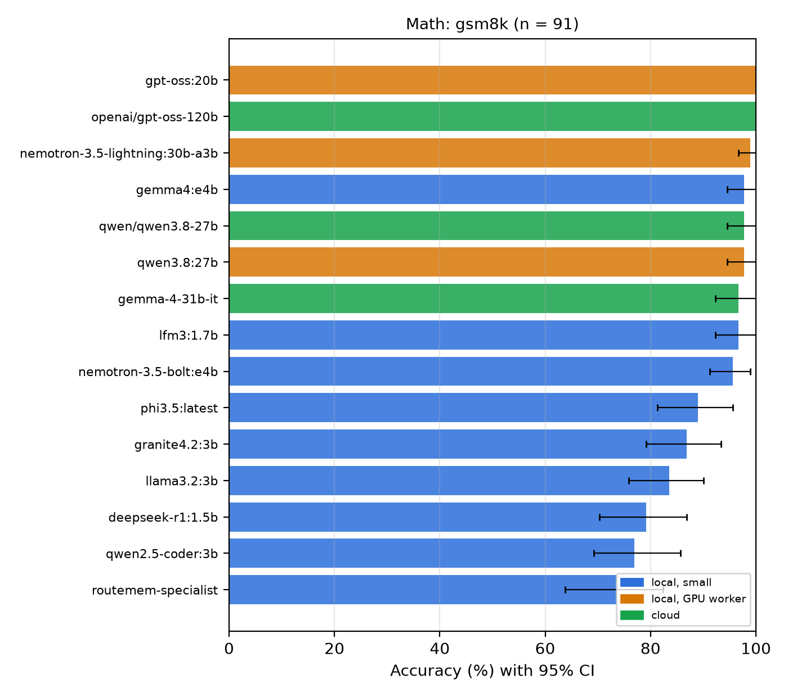
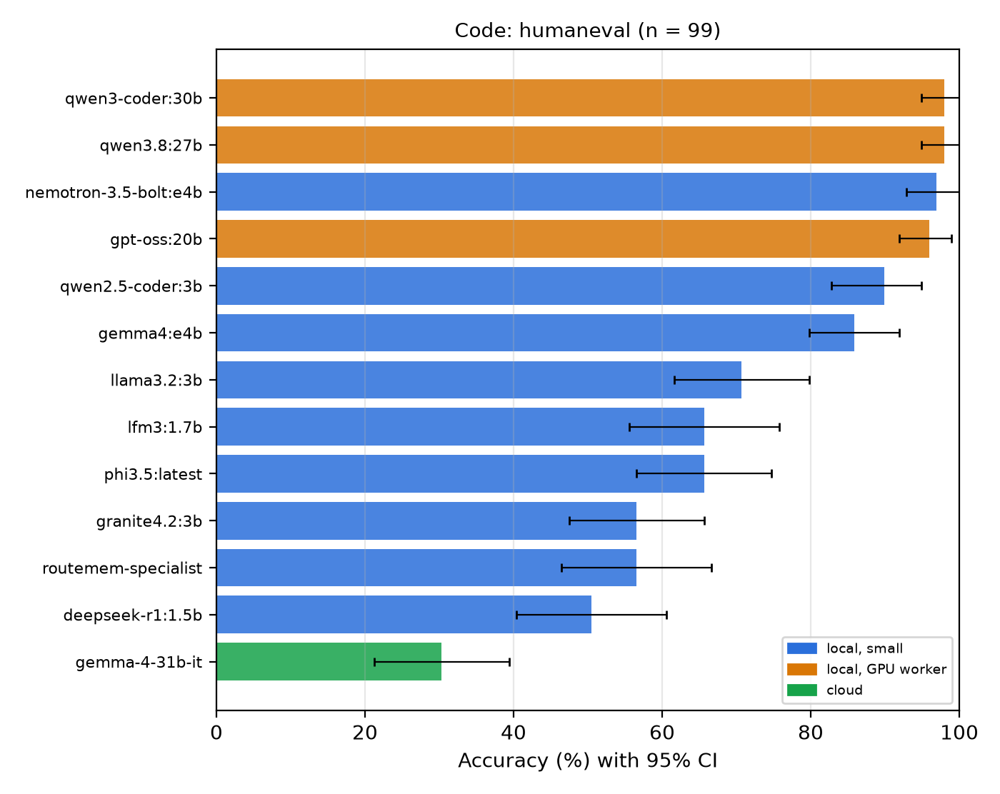
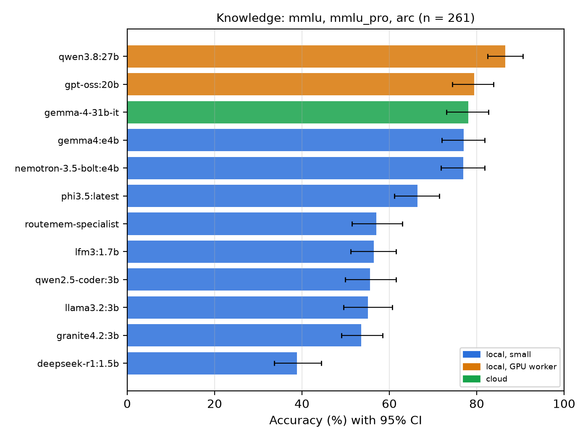
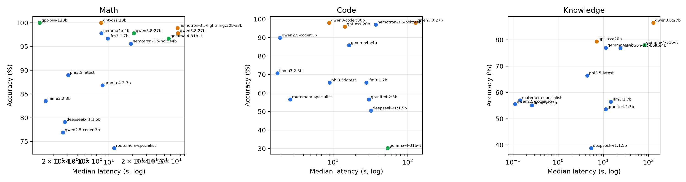

Cloud models ran on free tiers and were stopped when their quota ran out (Groq `gpt-oss-120b` after 227 questions,
Groq `qwen3.8-27b` after 146, Gemini 3.8 Flash at 0); they appear only where they answered enough questions.
`qwen3.8:27b` is the most accurate model overall but has a median of ~120 s per answer on one A10G, so it is used only
as the escalation target.

## 3. Routing

**Learned router (question only).** A logistic router on the gateway's own embedding, trained on 200 labels with
5-fold cross-validation, recovers 55% of the weak→strong quality gap on average (APGR 0.554) vs 0.500 for random
routing: significantly better than random (CI of the difference +0.05 to +0.20), not significantly better than the
heuristic profiler (−0.03 to +0.14). Per-task routers between `nemotron-bolt` and `gpt-oss:20b` were no better than
random: the two models are within 3 points of each other, so there is little to route on.

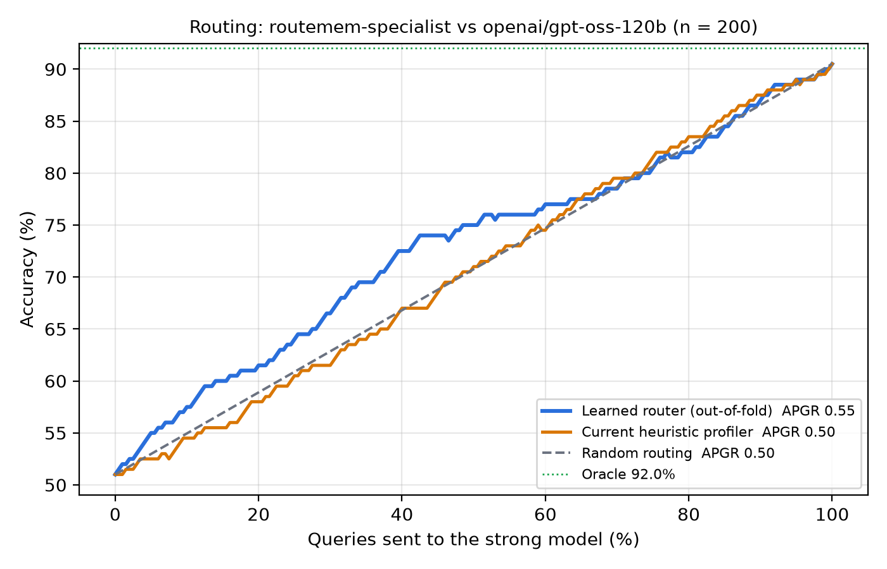

**Policies, replayed on 710 real answers** (every answer was produced and scored; only their combination is computed):

| Policy | Accuracy | vs task routing (95% CI) | Escalated | Median latency |
|---|---|---|---|---|
| `qwen3.8:27b` alone | 91.7% | +4.4 (+2.1 to +6.8) | – | 117 s |
| **Cascade: bolt + gpt-oss:20b agree, else qwen3.8:27b** | **91.0%** | **+3.7 (+1.8 to +5.4)** | 13% | 28 s |
| Cascade: gemma4:e4b + gpt-oss:20b agree, else qwen3.8:27b | 90.4% | +3.1 (+1.5 to +4.8) | 12% | 14 s |
| Majority vote of three | 87.6% | +0.3 (−1.1 to +1.7) | – | 26 s |
| Task routing (math/knowledge → gpt-oss:20b, code → bolt) | 87.3% | – | – | 10 s |
| `nemotron-bolt:e4b` alone | 84.8% | −2.5 (−4.8 to −0.4) | – | 25 s |

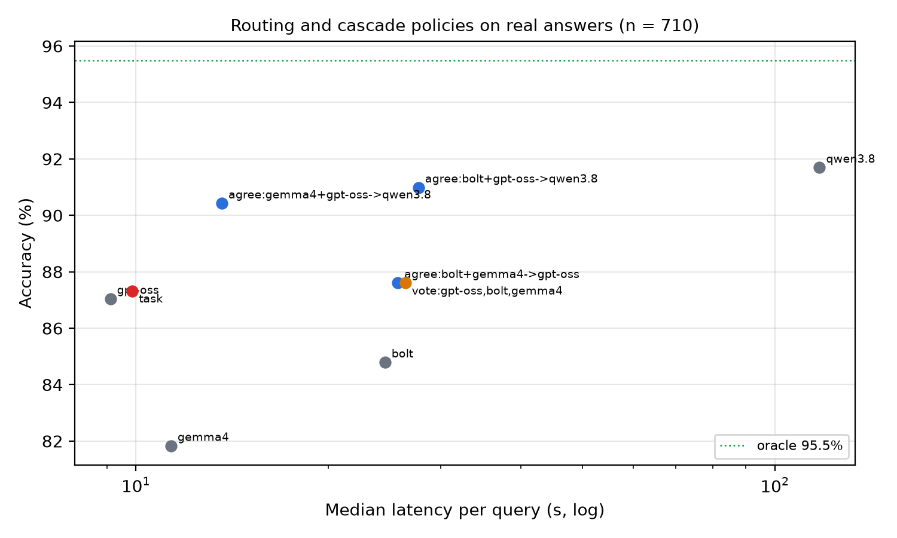

**Held-out validation (live, 240 questions never used for selection or training).**

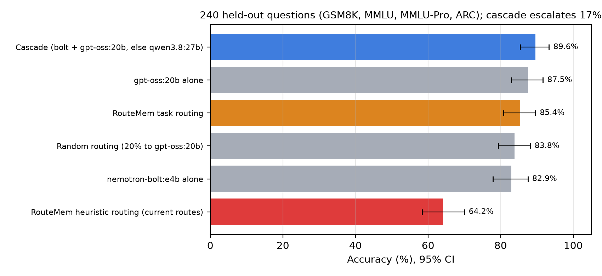

The cascade is again the most accurate (89.6%, 17% escalated), ahead of `gpt-oss:20b` alone by 2.1 points; at 240
questions that difference is not statistically significant (CI −0.8 to +5.4). The heuristic router that RouteMem
uses today scores 64.2%, below random routing between the same two models (83.8%). Both new modes are in the gateway:
`ROUTER_MODE=task` and `ROUTER_MODE=cascade` (`config/models.yaml`).

## 4. Compression (LLMLingua-2)

HotpotQA distractor questions (150; ten Wikipedia passages each, ~1,435 tokens), answered by `gpt-oss:20b` from the
full or compressed passages; the question itself is never compressed.

| Setting | Context tokens | Reduction | F1 | ΔF1 vs full (95% CI) |
|---|---|---|---|---|
| Full context | 1,435 | – | 77.8% | – |
| LLMLingua-2, rate 0.5 | 768 | 46% | 74.8% | −3.0 (−7.7 to +1.3) |
| LLMLingua-2, rate 0.33 | 491 | 66% | 61.9% | −15.8 (−21.7 to −9.8) |

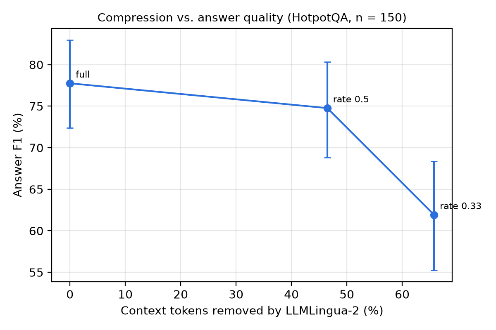

The gateway default (`COMPRESSION_RATE=0.5`) is the setting with no significant quality loss.

## 5. Fine-tuning

The v1 specialist (`routemem-specialist`) is 4.3 points worse than its own base, Llama 3.2 3B Instruct, on the same
1,364 questions (CI −6.7 to −1.8); on GSM8K it is 15.0 points worse and writes answers six times longer, consistent
with training on truncated long reasoning traces.

v2 was trained on 15,000 train-split examples (GSM8K, MetaMathQA, MMLU auxiliary, ARC, Magicoder) with loss on
responses only: 937 steps, 31.9 minutes on an A10G.

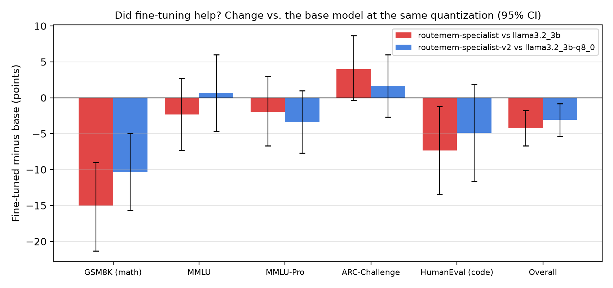

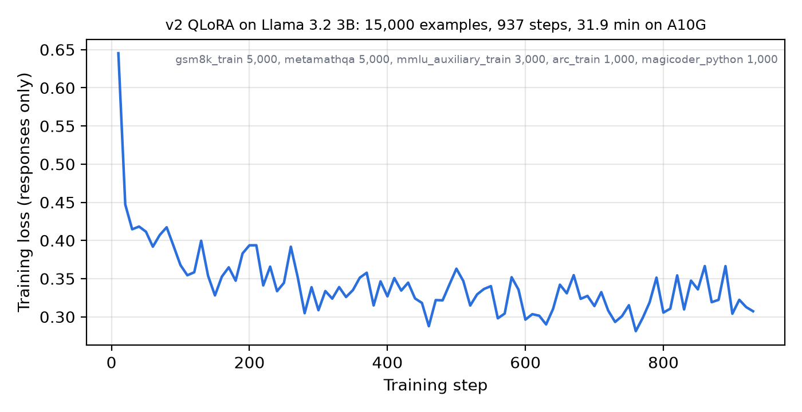

v2 was converted to GGUF q8_0 and compared with the base at the same q8_0 quantization, on the same 1,364
questions. It is **3.1 points worse overall** (61.2% → 58.1%, CI −5.4 to −0.8) and 10.3 points worse on GSM8K
(CI −15.7 to −5.0); MMLU and ARC are unchanged within their intervals. Its answers are half as long as the base's
(GSM8K: 84 vs 160 tokens): it learned the training data's short worked solutions and, from the multiple-choice
examples, to answer with a letter and no reasoning. v1 failed in the opposite direction (answers six times longer).

The practical conclusion: newer off-the-shelf small models (`nemotron-3.5-bolt:e4b`, `gemma4:e4b`) are about 20 points
ahead of either fine-tune, so routing between well-chosen models gains more than fine-tuning this 3B base.
Distilling a strong model's reasoning into one of those newer models is the variant worth trying next.

## Limitations

- **Sample sizes.** 100–300 questions per dataset give confidence intervals of roughly ±4–9 points; the held-out set
  (240) cannot separate differences of ~2 points.
- **Latency** was measured with 4–8 concurrent requests on one A10G, so queueing inflates it; it is a relative measure.
- **Cloud models** are under-represented because free-tier quotas ran out.
- **Contamination.** GSM8K, MMLU and HumanEval are public and may be in models' training data; MMLU-Pro is less exposed.
- **One sample per question at temperature 0**; no run-to-run variance is reported.
- **Replays** combine real answers but assume the gateway's prompt (system prompt, compression) does not change them.
- **LLMLingua-2 latency** (~13 s median) was measured while the GPU also served the reader model; standalone latency is lower and still to be measured.

## Reproducing

```bash
python3 scripts/run_real_benchmark.py all --n 100                      # end-to-end benchmark
python3 scripts/compare_models.py                                     # model selection + routing replay
python3 scripts/simulate_policies.py                                  # policy replay
python3 scripts/train_router_from_benchmark.py                        # learned router (5-fold CV)
python3 scripts/eval_cascade_holdout.py report --data-dir data/benchmarks/holdout_eval \
  --stage1 reports/holdout_eval/responses.jsonl --escalation-dir reports/holdout_eval/escalation
python3 scripts/eval_compression.py report                            # LLMLingua-2
python3 scripts/compare_finetune.py                                   # base vs fine-tuned
```

GPU jobs (g5.xlarge) are in `scripts/gpu/`; every run saves its raw answers, so all metrics can be recomputed
without calling a model.

## Architecture (as implemented)

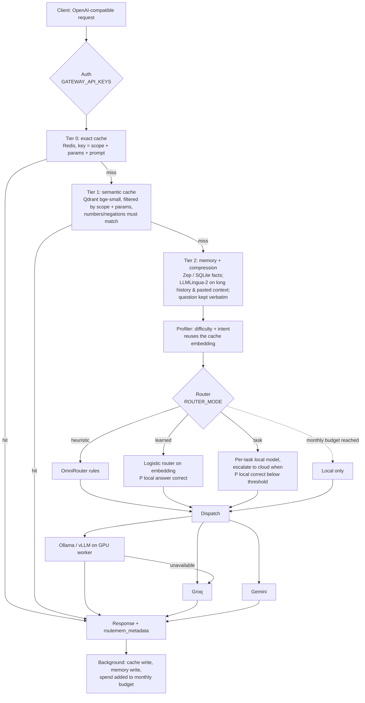

Every response reports what actually happened: the model and provider that answered
(`actual_answering_model`, `answering_provider`), any fallback and its reason, provider-reported token
usage, and cost from `config/pricing.yaml` (`null` when a model has no listed price). Backend failures
return HTTP 502 and are never cached.

## How the evaluation works

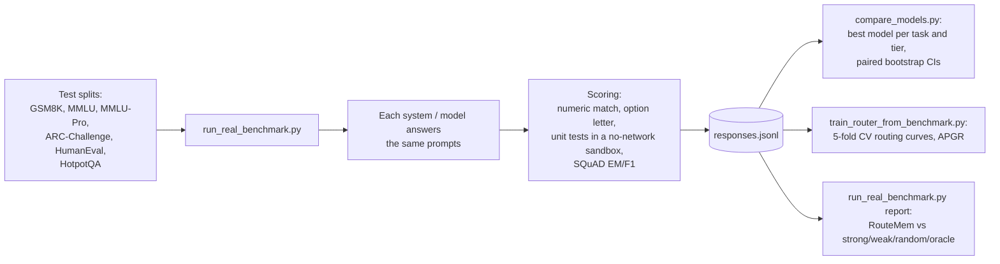

- **End-to-end runs** go through the gateway with `cache_mode: "bypass"`, so caches cannot inflate quality.
- **Random router baseline**: sends the same share of queries to the strong model as RouteMem did; beating it
  is what shows the routing itself helps.
- **APGR** (average performance gap recovered): the mean, over all strong-model shares, of how much of the
  weak→strong accuracy gap a router recovers. Random routing scores 0.50.
- **Confidence intervals** are 95% bootstrap intervals over questions; "significant" means the interval of a
  difference excludes zero.
